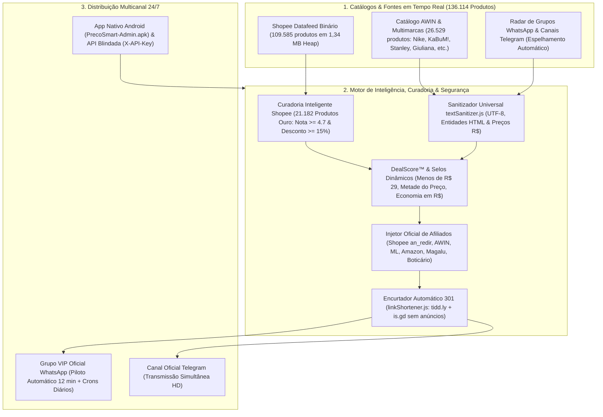

<div align="center">


# ⚡ PreçoSmart Ecosystem (v3.2 — Edição Especial de Fim de Ano)
### Plataforma Full-Stack Autônoma de Inteligência de Ofertas, Curadoria de Alta Conversão & Distribuição Multicanal de Afiliados

[](https://github.com/twazevedo/precosmart/actions)
[](https://nodejs.org/)
[](https://www.docker.com/)
[](https://github.com/WhiskeySockets/Baileys)
[](https://github.com/twazevedo/precosmart/security)
[](https://www.mongodb.com/)

<p align="center">
  <b>Motor 100% autônomo com catálogo indexado de 136.114 produtos (109.585 Shopee + 26.529 AWIN/Multimarcas), Curadoria Inteligente de Desejo, Encurtamento 301 Automático e operação silenciosa 24/7 no WhatsApp e Telegram.</b>
</p>

</div>

---

## 🏗️ Arquitetura do Sistema (v3.2)

O ecossistema foi projetado para rodar no **Render (512 MB RAM)** com **baixo consumo de memória (`~86 MB` Heap V8)**, **zero comandos manuais no WhatsApp** e **comissionamento garantido**:



---

## 💎 Principais Diferenciais da Versão 3.2

### 1. 🛍️ Catálogo Oficial Shopee de 109.585 Produtos (`shopeeCatalog.js`)
- Compactado em [`whatsapp-bot/shopeeFeedsData.tsv.gz`](whatsapp-bot/shopeeFeedsData.tsv.gz) (`7,96 MB`) e indexado em memória via `Buffer` + `Uint32Array`, consumindo apenas **`1,34 MB` de Heap V8** (carregamento em `90 ms`).
- **Curadoria Inteligente B2C:** Filtra automaticamente autopeças mecânicas e itens básicos de supermercado, priorizando os **`21.182` Produtos Ouro** de alta conversão (Casa, Beleza, Eletrônicos, Áudio, Moda, Calçados, Games, Pets) com **Avaliação `>= 4.7`** e **Desconto Real `>= 15% OFF`**.
- **Deep-Link Oficial no App:** Utiliza o redirecionador universal `https://s.shopee.com.br/an_redir?origin_link=...&affiliate_id=18361251220&sub_id=precosmart`, que abre diretamente o aplicativo da Shopee no celular do comprador e garante 100% da comissão.

### 2. 🎯 Selos Dinâmicos de Conversão & Cálculo de Economia
- **Achadinho Baratinho (`<= R$ 29,90`):** `🪙 *ACHADINHO BARATINHO — MENOS DE R$ 29 NA SHOPEE!* 🔥⚡`
- **Metade do Preço (`>= 45% OFF`):** `🚨 *METADE DO PREÇO NA SHOPEE — XX% OFF!* 💥⚡`
- **Campeão de Avaliações (`>= 4.9/5.0`):** `🏆 *CAMPEÃO DE AVALIAÇÕES (5.0/5.0) NA SHOPEE!* ⭐🔥`
- **Economia Real + Parcelamento:** Calcula e exibe automaticamente `💰 *Você economiza: R$ XX,XX na hora!*` e `💳 _ou em até 12x de R$ XX,XX no cartão_`.

### 3. 🔗 Encurtador Automático 301 Limpo (`linkShortener.js`)
- Converte todas as URLs longas de afiliados na hora do disparo usando a **Link Builder API oficial da AWIN (`tidd.ly`)** e **`is.gd` (`HTTP 301 Moved Permanently` puro)**, sem páginas intermediárias de anúncios e preservando cookies de afiliado.

### 4. 🧹 Sanitizador Universal de Textos e Preços (`textSanitizer.js`)
- Decodifica automaticamente entidades HTML numéricas e nomeadas (`&#199;`, `&#237;`, `&amp;`), corrige mojibake UTF-8, remove rótulos truncados (`DESCRIÇÃO:`, `.COMPOSIÇÃO`) e converte preços `BRL169.90` para o padrão brasileiro **`R$ 169,90`**.

### 5. 🛡️ Segurança OWASP ASVS & Zero Vulnerabilidades
- Autenticação administrativa estritamente via cabeçalho HTTP (`X-API-Key` ou `Authorization: Bearer`), comparação em tempo constante (`crypto.timingSafeEqual`), proteção Anti-SSRF (`isSafePublicUrl`) e criptografia `AES-256-GCM`.
- **0 vulnerabilidades** em todos os 5 pacotes do monorepo (`root`, `whatsapp-bot`, `backend`, `frontend`, `android-app`).

---

## 📊 Resumo do Catálogo Integrado (136.114 Produtos)

| Plataforma / Rede | Produtos Ativos | Destaques |
| :--- | :--- | :--- |
| **Shopee Brasil Oficial** | **109.585** | 21.182 itens na Curadoria Ouro (Nota `>= 4.7` & Desconto `>= 15%`) |
| **Catálogo AWIN & Multimarcas** | **26.529** | KaBuM!, Nike, Giuliana Flores, Stanley, C&A, Clovis, Olympikus, Mizuno, LEGO, LG, AliExpress, Decathlon, Venâncio |
| **Mercado Livre, Amazon & Magalu** | **Integrado + Tempo Real** | Cupons exclusivos `PRECOSMARTVIP`, Ofertas Relâmpago e Radar 24h |
| **TOTAL NO ECOSSISTEMA** | **136.114 Produtos** | **Rotação sem repetição persistida no MongoDB + Keep-Alive 24/7** |

---

## 🧪 Suíte de Testes Automatizados (30/30 Passando)

```bash
cd whatsapp-bot
node --test test/security.test.js test/professional_audit.test.js test/mirror.test.js
```

- [x] **`security.test.js` (9/9):** AES-256-GCM, Anti-Tampering, Header-Only Auth (`X-API-Key` / `Bearer`), OWASP Headers, Anti-SSRF.
- [x] **`professional_audit.test.js` (8/8):** Remoção de chaves estáticas, rejeição de tokens na query string, DealScore™, persistência `db.js` e formatação BRL.
- [x] **`mirror.test.js` (13/13):** Filtro Anti-Conversa/Anti-Notícia, injeção Amazon, Boticário/Eudora, Stanley, Decathlon, Venâncio, Alertas e Analytics.

---

## 🎨 Identidade Visual (Edição de Natal & Fim de Ano)

Os arquivos oficiais de marca (finalizados no **Adobe Photoshop 2025**) estão versionados em [`assets/branding/`](assets/branding/):
- [`assets/branding/precosmart_logo_natal_avatar.png`](assets/branding/precosmart_logo_natal_avatar.png) — Versão limpa para foto de perfil redonda (WhatsApp / Telegram / Instagram).
- [`assets/branding/precosmart_logo_natal_selo.png`](assets/branding/precosmart_logo_natal_selo.png) — Versão com selo dourado `• ESPECIAL DE NATAL & FIM DE ANO •`.
- [`assets/branding/precosmart_logo_natal_2025.psd`](assets/branding/precosmart_logo_natal_2025.psd) — Projeto editável em camadas do Adobe Photoshop 2025.

---

## 📄 Licença
Distribuído sob licença MIT. Desenvolvido para alta conversão e automação no e-commerce brasileiro.
